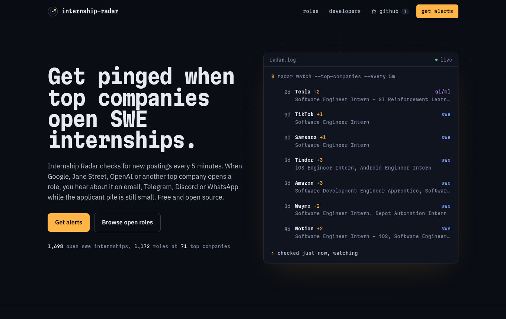
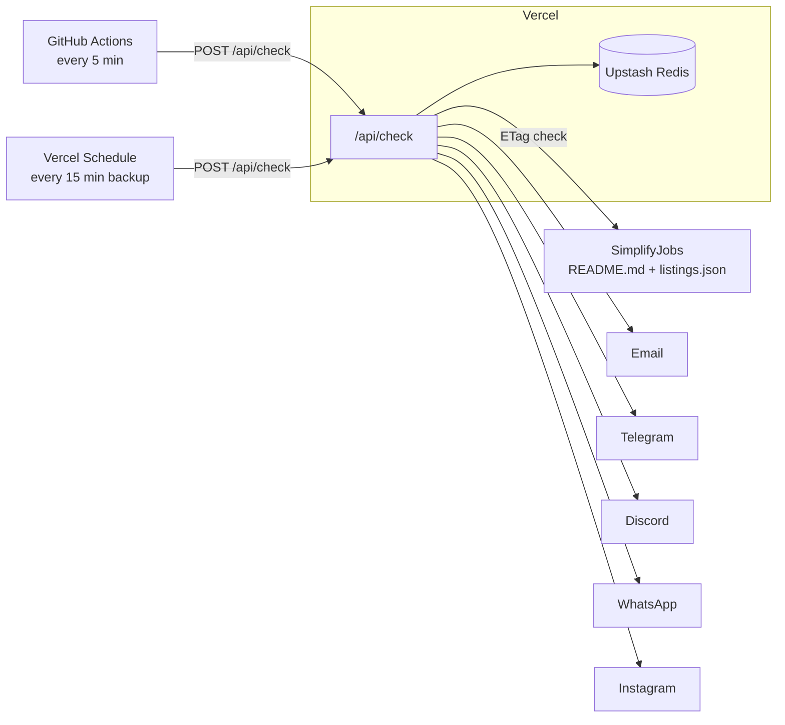

# Internship Radar

Get a message when top companies open SWE internships.

Internship Radar watches the [SimplifyJobs](https://github.com/SimplifyJobs) internship list every 5 minutes. When a FAANG+ company, top quant firm or AI lab posts a new role, it alerts subscribers on **email, Telegram, Discord or WhatsApp** and posts it to **Instagram**. Anyone can sign up from the public page and pick their own channels. A password-protected admin dashboard lets you manage everything.

It runs entirely on free tiers: Vercel Hobby, Upstash Redis free, and GitHub Actions.

**Live:** <https://internship-radar-xi.vercel.app>



## Features

- **Fast detection.** Polls every 5 minutes using cheap conditional requests (`ETag` / `304 Not Modified`) against the README and the `listings.json` file it's generated from. It does real work only when the list changes.
- **Hot companies.** Uses SimplifyJobs' own 🔥 FAANG+ list plus top quant firms and AI labs. You can add more from the admin page.
- **Five channels.**
  - Email via Gmail or any SMTP provider
  - Telegram bot with `/latest`, `/status` and `/stop`
  - Discord webhooks
  - WhatsApp, through Meta's Cloud API or the free CallMeBot service
  - Instagram auto-posts with generated image cards
- **Per-subscriber preferences.** Each subscriber chooses categories (SWE, AI/ML, quant, hardware, PM), top companies only or everything, and a personal watch list of companies.
- **No accounts.** Subscribers get a private manage link to change channels, send themselves a test, pause, or unsubscribe.
- **Admin dashboard.** Shows scheduler health and recent errors. It's also where you paste channel credentials (stored AES-GCM encrypted), manage subscribers, read the delivery log, and edit the company list.
- **Safe to retry.** A Redis lock plus a seen-set means overlapping triggers never send duplicate alerts. The first run saves a baseline instead of flooding everyone.
- **Discoverable.** A developer page at `/swe-internship-alerts` shows live GitHub stars, a posting-activity graph, and a FAQ backed by live data. It ships JSON-LD (`SoftwareApplication`, `SoftwareSourceCode`, `FAQPage`), a sitemap, a `robots.txt` that welcomes AI crawlers, and an [`/llms.txt`](https://llmstxt.org) summary for answer engines.
- **Follows new seasons.** Detects the newest `SummerYYYY-Internships` repo automatically and re-baselines silently when Simplify starts a new one.

## How it works



1. A trigger calls `/api/check`, authenticated with `CRON_SECRET`.
2. The checker sends conditional GETs for the README and `listings.json`. If neither changed, it stops there.
3. When the list changes, it normalises the listings and keeps open roles posted in the last 14 days. It diffs them against a Redis sorted set of IDs it has already seen.
4. New roles are matched against each subscriber's preferences and grouped by company, so a 20-role drop from Google is one message: *"🔥 Google just opened 20 SWE internship roles"*.
5. Each confirmed channel gets a formatted alert, and every delivery is logged for the admin page.

Why GitHub Actions? Vercel's free plan only allows cron jobs once a day, and its newer Schedules feature only every 15 minutes. GitHub Actions is free and unlimited for public repos and supports 5-minute schedules. GitHub can delay scheduled runs under heavy load, so the Vercel schedule acts as a backup.

## Channels

| Channel | How subscribers connect | What you set up | Notes |
| --- | --- | --- | --- |
| Email | Enter an address, click the confirmation link | Gmail address + [app password](https://myaccount.google.com/apppasswords) | Gmail allows about 500 emails a day |
| Telegram | Press **Start** on the bot from their manage page | A bot token from [@BotFather](https://t.me/BotFather) | Free, no limits that matter here |
| Discord | Paste a channel webhook URL | Nothing | A test message confirms it |
| WhatsApp | Phone number, plus a CallMeBot key if Cloud API isn't set up | Optional: Meta WhatsApp Cloud API | See below |
| Instagram | Follow your account | A long-lived Instagram API token | Posts, not DMs (see below) |

### Email (Gmail)

1. Turn on 2-Step Verification for the Gmail account.
2. Create an app password at <https://myaccount.google.com/apppasswords>.
3. Paste both in **Admin → Channels → Email**. Leave "Also subscribe this address" ticked to get alerts yourself.

Any SMTP provider works: expand "Use a different SMTP provider".

### Telegram

1. Message [@BotFather](https://t.me/BotFather), send `/newbot`, and copy the token.
2. Paste it in **Admin → Channels → Telegram** and click **Connect bot**. This registers the webhook (`/api/telegram/webhook`, verified with a secret header) and the bot commands.

### Discord

There's nothing to configure. Subscribers create a webhook in their own server (**Channel settings → Integrations → Webhooks → New Webhook → Copy Webhook URL**) and paste it on the signup form.

### WhatsApp

WhatsApp has no free official bot API, so there are two modes:

- **CallMeBot (default, free).** Each subscriber follows step 1 on [CallMeBot's page](https://www.callmebot.com/blog/free-api-whatsapp-messages/) to get a personal API key, then enters their number and key on the signup form. It's unofficial and has had outages, which the delivery log will show.
- **Meta WhatsApp Cloud API (official).** Create a Meta developer app with the WhatsApp product, then enter the access token and phone number ID in the admin page. The free test number can message up to 5 verified phones. Business-initiated messages outside a 24-hour chat window need an approved template. Create a Utility template named `internship_alert` with three body variables:

  ```
  {{1}}

  Roles: {{2}}

  Apply: {{3}}
  ```

  Meta charges per template message beyond the free allowances, usually a fraction of a cent to a few cents depending on the country.

### Instagram

Instagram doesn't let bots DM people who haven't messaged the account in the last 24 hours, so proactive DM alerts aren't allowed. Instead, Internship Radar posts every hot SWE drop as an image card to your Instagram Business or Creator account (at most 3 per check and 20 a day), and subscribers follow that account.

1. Switch your Instagram account to Business or Creator.
2. Create an app at <https://developers.facebook.com>, add the **Instagram API with Instagram Login** product, and add your account as a tester.
3. Generate a long-lived access token with the `instagram_business_basic` and `instagram_business_content_publish` permissions.
4. Paste it in **Admin → Channels → Instagram**. It refreshes automatically before its 60-day expiry.

## Deploy your own

1. **Fork** this repo. Keep it public so GitHub Actions minutes stay free.
2. **Import it on Vercel** (<https://vercel.com/new>). The Hobby plan is enough.
3. **Add Redis.** In the Vercel project go to **Storage → Create Database → Upstash for Redis** (free plan) and connect it to the project. This adds the `KV_REST_API_*` variables.
4. **Add environment variables** under **Settings → Environment Variables**, each a random string (`openssl rand -base64 32`):
   - `APP_SECRET` signs admin sessions and encrypts stored credentials
   - `CRON_SECRET` authenticates the scheduler
   - `ADMIN_PASSWORD` is the dashboard password
5. **Redeploy**, then open `/admin`, sign in, and set up your channels.
6. **Turn on the 5-minute trigger.** In your GitHub repo:

   ```bash
   gh variable set APP_URL --body "https://your-app.vercel.app"
   gh secret set CRON_SECRET   # paste the same value as on Vercel
   gh workflow run check.yml   # first run saves the baseline
   ```

The first check records everything currently listed as already seen. Alerts start with the next new listing.

## Configuration

| Variable | Required | Description |
| --- | --- | --- |
| `APP_SECRET` | yes | Signs sessions and encrypts stored channel credentials. Changing it wipes saved credentials. |
| `CRON_SECRET` | yes | Bearer token for `/api/check`. Also sent by Vercel Schedules. |
| `ADMIN_PASSWORD` | yes | Password for `/admin`. |
| `KV_REST_API_URL`, `KV_REST_API_TOKEN` | yes | Upstash Redis REST credentials. `UPSTASH_REDIS_REST_*` also works. |
| `APP_URL` | no | Public URL. Defaults to the Vercel production domain. |
| `GITHUB_TOKEN` | no | A token with no scopes, used for the star count and repo stats on the developer page. It raises GitHub's limit from 60 to 5,000 requests an hour. Stats are cached for 10 minutes either way. |
| `SIMPLIFY_REPO`, `SIMPLIFY_BRANCH` | no | Pin a source repo instead of auto-detecting. Default branch is `dev`. |
| `GMAIL_USER`, `GMAIL_APP_PASSWORD`, `SMTP_HOST`, `SMTP_PORT`, `EMAIL_FROM` | no | Email settings. These override the admin page. |
| `TELEGRAM_BOT_TOKEN` | no | Overrides the admin page. Connect it from the admin page once to register the webhook. |
| `WHATSAPP_TOKEN`, `WHATSAPP_PHONE_NUMBER_ID`, `WHATSAPP_TEMPLATE`, `WHATSAPP_TEMPLATE_LANG` | no | Meta WhatsApp Cloud API. |

## Local development

```bash
npm install
npm run dev            # http://localhost:3000, uses an in-memory store without Redis
curl -X POST localhost:3000/api/check   # run a check (no secret needed locally)
npm test               # unit + integration tests (no network)
npm run lint && npm run typecheck
```

Locally, `/admin` accepts the password `admin` unless `ADMIN_PASSWORD` is set. Copy `.env.example` to `.env.local` to point at a real Redis.

## Project layout

```
src/
  app/
    page.tsx                  public page: live drops, roles board, signup
    swe-internship-alerts/    developer page: GitHub-style, SEO/AEO content
    llms.txt, robots.ts, sitemap.ts, opengraph-image.tsx
    manage/[token]/page.tsx   subscriber self-service
    admin/                    dashboard + server actions
    api/check                 the polling endpoint
    api/roles                 board data
    api/telegram/webhook      Telegram bot
    api/verify/email          email confirmation
    api/instagram/card/[id]   JPEG cards for Instagram posts
  lib/
    checker.ts                one polling cycle: lock, ETag checks, diff, notify
    simplify.ts               SimplifyJobs fetching and normalisation
    companies.ts              hot company list and matcher
    match.ts                  subscriber preference matching and alert grouping
    format.ts                 per-channel message formatting
    channels.ts               email, Telegram, Discord, WhatsApp, Instagram senders
    subscribers.ts            sign-up, verification, manage links
    settings.ts               encrypted channel credentials
    kv.ts                     Redis wrapper with an in-memory fallback
    seo.ts, github.ts         FAQ + JSON-LD content, cached GitHub stats
    activity.ts               daily posting counts for the activity graph
tests/                        vitest suites
```

## Credits

Listings come from the open-source [SimplifyJobs](https://github.com/SimplifyJobs) internship lists maintained by [Simplify](https://simplify.jobs) and the [Pitt Computer Science Club](https://pittcsc.org). This project isn't affiliated with either. If you find it useful, star their repo.

## License

[MIT](LICENSE)
